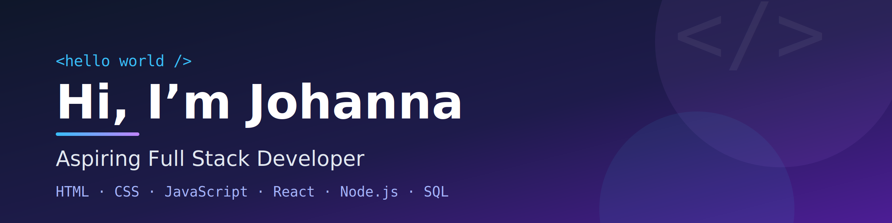

  

 

  

 

## Hi there 👋

Hi! I'm Johanna, a Business Informatics student based in Cluj-Napoca, Romania, passionate about web development and UI/UX design.

I'm expanding my skills toward full-stack development, building on HTML, CSS, JavaScript, and React while exploring Next.js, TypeScript, Node.js, and PostgreSQL. I enjoy creating modern, responsive web applications with clean code, thoughtful design, and great user experiences.

## ⚡ Tech Stack & Tools

  

